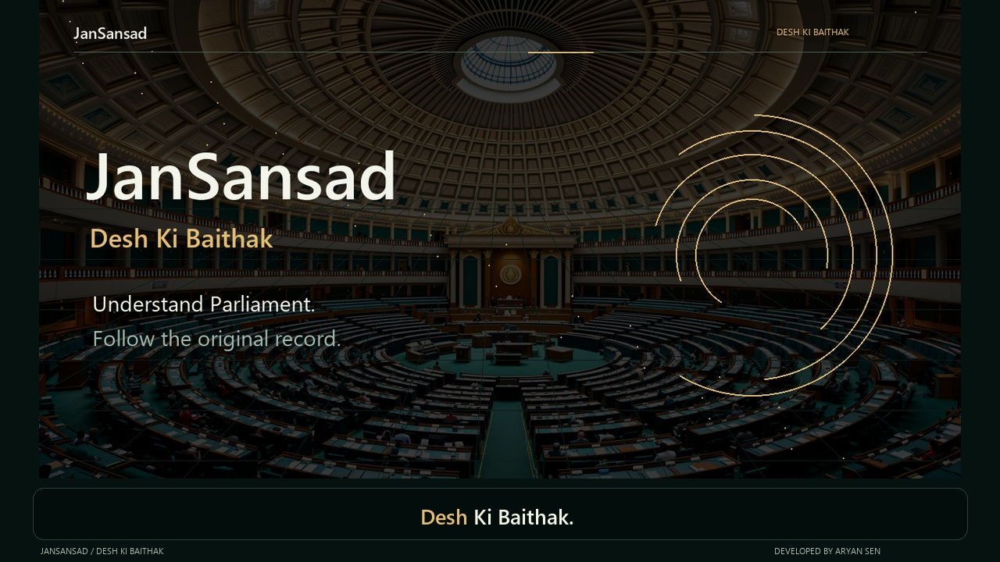
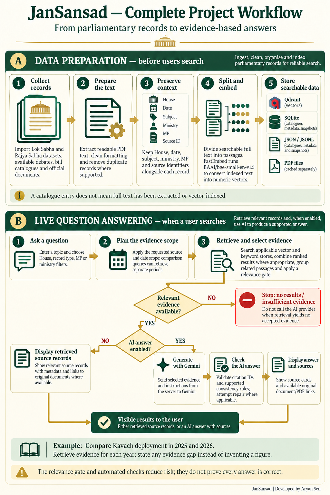
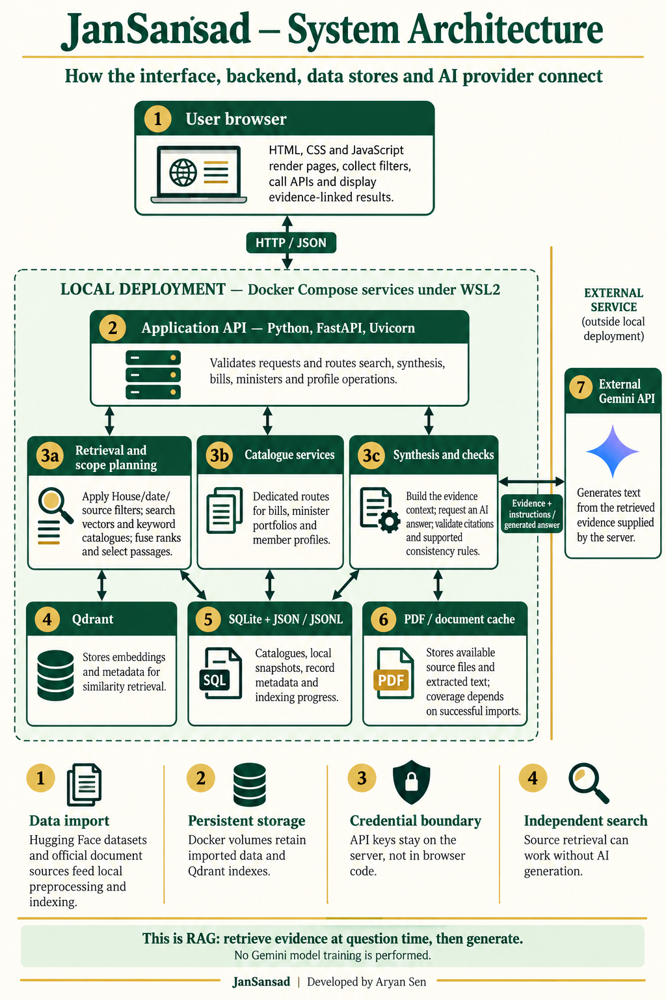
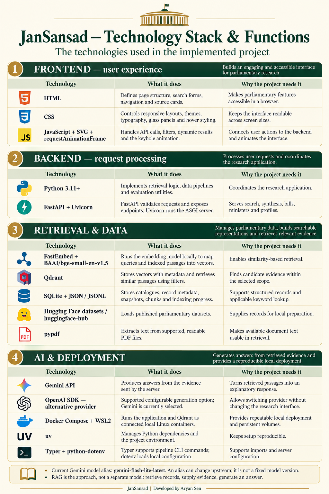

<div align="center">

# जनसंसद | JanSansad
### देश की बैठक · Desh Ki Baithak

**Explore Parliament. Ask questions. Follow the evidence.**


Developed by **[Aryan Sen](https://github.com/aryanvector)**

[Video demo](#project-introduction-video) · [Features](#features) · [Installation](#installation-one-step-at-a-time) · [Workflow](#detailed-workflow) · [Architecture](#system-architecture) · [Troubleshooting](#troubleshooting)

</div>

## About

JanSansad is an AI-assisted research platform for Indian parliamentary records. Search imported Lok Sabha and Rajya Sabha questions, explore available debate text and bill records, and generate explanations linked to retrieved evidence.

It extends [Sammit Jain's lok-sabha-rag](https://github.com/sammitjain/lok-sabha-rag) with cross-House integrations, bills and minister interfaces, scope-aware retrieval, answer checks and a bilingual responsive frontend. Original MIT attribution is preserved.

## Project introduction video

A **1 minute 53 second** introduction, narrated by **Aryan Sen**, covering the platform, bill exploration, evidence-linked answers, animated workflow and system architecture. The video includes captions, an English translation of the Hindi opening, and developer contact links.

[](https://raw.githubusercontent.com/aryanvector/JanSansad/main/docs/media/jansansad-client-pitch.mp4)

**[Download and play the video (MP4, 17.6 MB)](https://raw.githubusercontent.com/aryanvector/JanSansad/main/docs/media/jansansad-client-pitch.mp4)** · [Subtitles: SRT](docs/media/jansansad-client-pitch.srt) · [Subtitles: WebVTT](docs/media/jansansad-client-pitch.vtt)

Click the preview image or the download link, then open the saved MP4 in your video player. GitHub's repository file-preview page does not display this large video, so these links go directly to the file.

The product footage reflects the recorded local demo and its snapshot-based coverage; it is not a live parliamentary feed. Captions are already visible in the video; the separate subtitle files are provided for reuse.

## Features

| Area | What you can do |
|---|---|
| Questions & debates | Search imported records; filter by House, record type, MP and ministry |
| AI answers | Generate explanations from retrieved passages using Gemini, with source references |
| Comparisons | Retrieve evidence across requested periods and report coverage limitations |
| Bills & Acts | Explore imported catalogue records, milestones and available official documents |
| People | Search minister snapshots and inspect available member profiles |
| Interface | Bilingual branding, themes, responsive glass panels and clear navigation |

**Engineering focus:** retrieval-augmented generation (RAG), vector and catalogue search, metadata filtering, evidence selection, provider integration and persistent container services. Existing models are used; Gemini is not trained on the dataset.

## Prerequisites

| Required | Install / check |
|---|---|
| Git | [Download Git](https://git-scm.com/downloads) |
| Docker with Compose | Windows/macOS: [Docker Desktop](https://www.docker.com/products/docker-desktop/). Linux: Docker Engine with the Compose plugin also works |
| WSL2 — Windows only | Enable Docker Desktop's WSL2 backend. Follow [Docker's Windows instructions](https://docs.docker.com/desktop/setup/install/windows-install/) if needed |
| Internet access | Needed for initial dependencies, model/data downloads and AI calls |
| Gemini API key — optional | Needed for AI answers; source search can work without a key |

**No separate Python, Node.js, Qdrant or uv installation is needed for the Docker setup.** Allow several GB of free storage for containers, models and records. Larger imported corpora need more space.

## Installation: one step at a time

Use **PowerShell on Windows**. On macOS/Linux use Terminal; the copy and editor commands differ as noted. Run each step separately.

### 1. Start Docker Desktop

Open Docker Desktop and wait until its engine is running. Keep it open.

### 2. Check Git

```powershell
git --version
```

You should see a version number. If missing, install Git and reopen PowerShell.

### 3. Check Docker Compose

```powershell
docker compose version
```

You should see a Compose version.

### 4. Download the code

```powershell
git clone https://github.com/aryanvector/JanSansad.git
```

### 5. Enter the folder

```powershell
cd JanSansad
```

Run the remaining commands from this folder.

### 6. Create your local configuration

```powershell
Copy-Item .env.example .env
```

macOS/Linux: `cp .env.example .env`.

### 7. Configure AI answers, if wanted

```powershell
notepad .env
```

Set these lines, insert your own Gemini key, then save:

```dotenv
AI_PROVIDER=gemini
GEMINI_API_KEY=PASTE_YOUR_GEMINI_KEY_HERE
GEMINI_MODEL=gemini-flash-lite-latest
OPENAI_API_KEY=
```

Get your key from [Google AI Studio](https://aistudio.google.com/apikey). The value above is a placeholder. Never share or commit your actual `.env`. On macOS/Linux use any text editor.

**Without a key:** leave both template keys empty and keep `AI_PROVIDER=auto`. Turn **AI answer** off on the website to use document search. AI generation needs a valid key and available provider quota.

### 8. Build and start

```powershell
docker compose up --build -d
```

The first build downloads dependencies and the embedding model. Startup also attempts to download the upstream Lok Sabha snapshot and metadata. The website may not be ready immediately after this command returns.

### 9. Watch startup progress

```powershell
docker compose logs -f app
```

Wait for the Uvicorn server startup message. **Ctrl+C** stops following logs; it does not stop the app.

### 10. Open JanSansad

Open **[http://localhost:8000/](http://localhost:8000/)**.

Try a narrow topic such as **Kavach** or **railway safety**. Check the data-coverage panel before selecting other Houses or record types.

## What a fresh installation contains

**The complete development corpus is not bundled.** GitHub contains application code, the bundled minister snapshot, documentation and diagrams. Local databases, Qdrant volumes and PDF caches stay outside Git.

| Data | Fresh-install expectation |
|---|---|
| Lok Sabha vectors and statistics | Startup attempts an upstream Hugging Face snapshot and metadata download; success depends on network and source availability |
| Rajya Sabha Q&A and keyword catalogue | Additional documented imports required |
| Debates | Import and indexing required; catalogue records do not imply extracted full text |
| Bills and cached PDFs | Catalogue import required; document availability varies |
| Ministers | Bundled source snapshot, with incomplete coverage and source-date limitations |

If upstream downloads fail, the app may start with limited or empty search/statistics. This is different from the website itself failing to start.

After the basic app works, follow the focused guides for additional data:

- [Rajya Sabha integration](docs/rajya-sabha-integration.md)
- [Kaggle catalogue and deduplication](docs/kaggle-combined-corpus.md)
- [Debate catalogue and full-text indexing](docs/fulltext-debates.md)
- [Bills catalogue](docs/bills-and-acts.md) and [PDF questions](docs/bill-pdf-qa.md)
- [Minister coverage](docs/minister-directory.md)
- [Gemini configuration](docs/gemini-provider.md)

These are extra data-preparation workflows, not requirements simply to build and open the app. Dataset terms are separate from the software licence.

## Everyday commands

**Start again:** open Docker Desktop, open PowerShell in the project folder, then:

```powershell
docker compose up -d
```

**Stop:** persistent volumes remain available for the next start.

```powershell
docker compose stop
```

**After changing an API key:** save `.env`, then recreate the app to apply its environment.

```powershell
docker compose up -d --force-recreate app
```

**Update:** if you have no local changes to preserve, first:

```powershell
git pull
```

Then rebuild:

```powershell
docker compose up --build -d
```

## Troubleshooting

| Problem | Try this |
|---|---|
| Git not recognised | Install Git, then reopen the terminal |
| Docker cannot connect | Start Docker Desktop and check WSL2 integration on Windows |
| Website does not open | Run `docker compose ps`, then `docker compose logs --tail 80 app` |
| First start is slow | Check logs: model and snapshot downloads can be large |
| Search has no results | Check imported coverage, choose the correct House and narrow the topic |
| AI unavailable | Check provider, key and quota; recreate the app after editing `.env` |
| Port 8000 occupied | Stop the previous installation or other app using that port |
| Some records/PDFs missing | Import the relevant corpus and check source availability |

Do not paste keys or unredacted `.env` files into issues. Do not delete Docker volumes for routine troubleshooting: they contain imported data.

## Detailed workflow

**Question + filters → scoped retrieval → evidence selection → search results or AI answer → source-linked output.**

In AI mode, selected evidence is sent to Gemini. Citation identifiers and supported consistency rules are checked. With no accepted evidence, the system should return a no-results or insufficient-evidence response.



[Open full-resolution workflow](docs/assets/jansansad-workflow.png).

## System architecture



[Open full-resolution architecture](docs/assets/jansansad-architecture.png).

The browser calls a Python API. Retrieval and catalogue services use Qdrant, SQLite and JSON/JSONL. AI synthesis calls an external provider with server-side credentials. Docker volumes persist local data.

## Technology stack and functions

| Technology | Function |
|---|---|
| HTML / CSS / JavaScript | Interface, filters, source cards and native SVG animation |
| Python / FastAPI / Uvicorn | Validation, API endpoints and backend orchestration |
| FastEmbed / BAAI/bge-small-en-v1.5 | Local query and passage embeddings |
| Qdrant | Vector similarity retrieval with metadata filters |
| SQLite / JSON / JSONL | Catalogues, metadata, snapshots and indexing state |
| Hugging Face datasets / pypdf | Imports and readable PDF text extraction |
| Gemini / alternative OpenAI provider | Evidence-conditioned generation |
| Docker Compose / WSL2 / uv | Local services, persistence and dependencies |



[Open full-resolution technology guide](docs/assets/jansansad-tech-stack.png).

Diagrams are AI-generated explanatory illustrations reviewed against the implementation. Source code and written documentation give precise implementation details.

## Project structure

```text
frontend/                   Interface, styles and animation
src/lok_sabha_rag/api/       API routes and request schemas
src/lok_sabha_rag/core/      Retrieval, catalogues, providers and checks
src/lok_sabha_rag/pipeline/  Import and indexing pipelines
src/lok_sabha_rag/resources/ Bundled public-source minister snapshot
scripts/                    Data preparation and utility commands
tests/                      Backend and frontend checks
docs/                       Guides and diagrams
```

## Validation and research scope

Automated tests cover retrieval helpers, relevance, answer checks, provider errors and catalogues. Some evaluation tests require development-only fixtures or imported corpora; this is not a self-contained copy of every research experiment.

The research focus is complete, correctly scoped evidence recovery for parliamentary comparisons. Interface features alone do not establish novelty or publication readiness. Independent scoring and source verification are distinct from automated checks.

## Sources and limitations

- [Digital Sansad](https://sansad.in/)
- [Lok Sabha Q&A](https://huggingface.co/datasets/opensansad/lok-sabha-qa)
- [Upstream snapshot and metadata](https://huggingface.co/datasets/opensansad/lok-sabha-rag-data)
- [Rajya Sabha Q&A](https://huggingface.co/datasets/anudit/rajyasabha-qa)
- [Rajya Sabha catalogue](https://www.kaggle.com/datasets/rajanand/rajyasabha)

Coverage depends on imports and is not universally live or complete. Minister records are snapshots. Valid citation IDs do not prove sentence-level support. Verify important claims against originals. Data and third-party asset rights are separate from the software licence.

## Attribution and licence

Developed and extended by Aryan Sen. Based on lok-sabha-rag; original MIT attribution retained.

## Connect

[](https://github.com/aryanvector)
[](https://www.linkedin.com/in/aryan1029/)
[](https://www.instagram.com/nvn.aryxn/)
